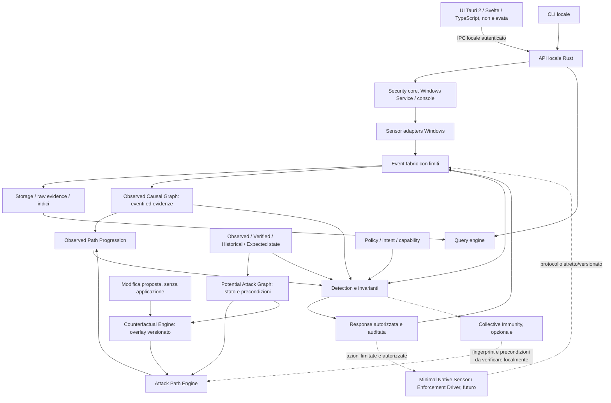

# Architettura di piko

Stato: decisioni della phase 0 e contratto di evoluzione. Data: 2026-10-04.

Il requisito originale è conservato integralmente in [REQUIREMENTS.md](REQUIREMENTS.md), integrato dall'[addendum architetturale](ARCHITECTURAL_ADDENDUM.md). Il progetto esistente è trattato come brownfield: [audit componenti](COMPONENT_AUDIT.md) e [decisioni linguistiche](LANGUAGE_DECISIONS.md) precedono nuove feature o migrazioni. La versione `0.1.0` raccoglie eventi Windows Event Log con raw e bookmark, contiene il lifecycle SCM e mantiene la diagnostica del runtime; **non è un antivirus, non blocca attacchi e non attesta che Windows sia protetto**. Lo stato effettivamente realizzato e i criteri mancanti sono in [ROADMAP.md](ROADMAP.md). Un modulo nominato in questo documento non implica che esista già nel codice.

## Invarianti del prodotto

Slice corrente: [ADR 0009](adr/0009-detection-response-recovery.md), successiva
all'[ADR 0008](adr/0008-windows-service-and-event-log.md).
`win-platform` possiede handle SCM/Event Log/pipe; `win-sensors` normalizza in safe
Rust e alimenta una coda limitata per byte e numero. Il writer salva evento, XML
e bookmark nella stessa transazione. Il cursore viene letto dal payload verificato
della sorgente. UI e CLI leggono anche raw evidence per UUID. I livelli del registro
Windows non costituiscono detection: `security-core` applica quattro regole
esplicite e lo storage salva le segnalazioni nella stessa transazione degli
eventi. `response-engine` implementa quarantena e recovery del contenuto tramite
worker distinto: piano, autorizzazione del caller, hash/identità file, backup
DPAPI, journal e verifica dell'effetto. Gli altri engine del diagramma restano
di progetto. Le capacità e i limiti della 0.2.0 sono in [RESPONSE.md](RESPONSE.md).

Il nucleo condiviso è `event fabric + grafo causale + stato storico + policy/intent`. Identity, provenance, integrity, authorization, capability e behavior rimangono dimensioni distinte. Una firma valida prova un'origine secondo una catena di fiducia; non autorizza qualunque comportamento. Sconosciuto non significa malevolo. L'avvio di un eseguibile non equivale a un consenso universale.

Ogni decisione futura deve indicare eventi, soggetto, risorsa, regola/versione, capacità di osservazione disponibile, grado di inferenza e risultato dell'azione. L'assenza di telemetria non può diventare uno stato verde. Non sono previste edizioni con livelli artificialmente differenti di sicurezza; le capacità dipendono dal sistema operativo, dall'hardware e dagli endpoint realmente collegati.

## Processi e responsabilità

Il frontend presenta dati ricevuti dal backend Rust e non prende decisioni di sicurezza. Il runtime è indipendente dalla finestra; chiudere la UI deve terminare WebView e frontend, lasciando attivo il runtime avviato separatamente. La prima slice usa il processo console: avvio automatico, SCM, installazione privilegiata, recovery actions e disinstallazione pulita richiedono una successiva integrazione verificata. Nessuna installazione o elevazione automatica avviene durante lo sviluppo.

Il servizio di produzione avrà identity dedicata, privilegi minimi per adapter, configurazione protetta e ACL per dati/programmi. Un processo `SYSTEM` non è un confine sufficiente contro un amministratore ostile o un kernel compromesso. La UI non può scegliere percorsi arbitrari da far aprire al servizio né inviare comandi shell.

## Confini dei moduli

| Livello | Moduli | Contratto |
| --- | --- | --- |
| Tipi fondamentali | `common-model`, `event-schema` | Tipi versionati senza dipendenza da UI, SQLite o API Windows |
| Acquisizione | `win-platform`, `win-sensors` | Windows FFI confinata; osservazioni e health espliciti |
| Pipeline | `event-fabric`, `event-storage` | Buffer limitati, sequenze, batch, storage sostituibile |
| Interpretazione | `causal-graph`, `attack-path-engine`, `counterfactual-engine`, `query-engine`, `detection-engine` | Identificatori condivisi, semantiche distinte, riferimenti a evidenze; nessuna scrittura raw retroattiva |
| Memoria e policy | `policy-engine`, `intent-engine`, `capability-engine`, `software-inventory`, `software-genealogy` | Versioni, transazioni, autorizzazioni con durata/scope |
| Analisi specializzate | `identity-engine`, `network-engine`, `deception-engine`, `ransomware-engine`, `vulnerability-engine` | Alimentano lo stesso grafo e gli stessi incidenti |
| Azione | `response-engine`, `recovery-model` | Prerequisiti, dry-run ove utile, evidenze, risultato reale |
| Trasporto/fiducia | `ipc`, `crypto-core`, `fleet-protocol` | Limiti, autenticazione, autorizzazione, provider crypto |
| Composizione | `apps/security-service`, `apps/cli`, `apps/desktop-ui` | Wiring e lifecycle; dipendenze orientate verso i tipi |
| Futuro opzionale | coordinator, recovery tool, driver | Aggiunti quando la slice locale è verificata |

Non si creano crate vuoti per simulare funzionalità. Le dipendenze devono formare un DAG; gli engine dipendono da interfacce e modelli, mai dall'app o dalla UI. `unsafe` è vietato dove non serve; Windows FFI è confinata in wrapper con ownership, lifetime e commenti `SAFETY`. Nei percorsi runtime gli errori sono espliciti e non risolti tramite `unwrap()` o panic.

La strategia è **memory-safe by default, platform-native when justified**. Safe Rust rimane il default per engine, storage, orchestrazione e logica del servizio. C è ammesso per un piccolo boundary Windows/WDK quando il confronto documentato dimostra minore rischio complessivo. Il driver non contiene grafi, SIEM, database, threat intelligence, ML o policy complesse. Nessuna parte Rust esistente viene convertita per raggiungere un obiettivo linguistico. Gate e test comparativi sono definiti nelle decisioni linguistiche.

## Pipeline ed evidenze

`raw → normalized → enriched → detection → incident` conserva riferimenti e versioni di parser. Il raw è immutabile dopo l'acquisizione, entro limiti di retention e privacy espliciti; non si raccoglie contenuto personale per il solo motivo che un provider lo rende disponibile. Un parser aggiornato produce una nuova derivazione, senza riscrivere l'evidenza precedente.

Il writer SQLite usa WAL e batch. Il design ad alto volume aggiungerà segmenti append-only compressi, manifest, chain e checkpoint: la sola presenza di SQLite non soddisfa questo requisito. WAL consente lettori concorrenti con lo scrittore, ma non elimina lock, checkpoint, contesa e crescita dovuta a lettori lunghi; database e file WAL devono stare su storage locale supportato. [SQLite WAL](https://www.sqlite.org/wal.html), verificato 2026-10-04.

La queue è limitata per numero di eventi e il payload per dimensione. Saturazione e gap producono contatori e `TelemetryLossEvent`; una corsia/riserva per health evita che il messaggio di perdita scompaia nel medesimo overload. La pipeline non blocca thread Windows critici. Il drain di shutdown ha una scadenza e dichiara eventuali eventi non persistiti.

Nella slice corrente il database è posseduto da un singolo worker dedicato, con coda limitata a otto richieste. Il loop async mantiene heartbeat e snapshot health e ammette al massimo quattro client. I batch rimangono in memoria fino alla conferma di commit; richieste di lettura scadute vengono rifiutate. La verifica locale può fallire per scadenza su archivi grandi: questo non significa corruzione. Un deadline cooperativo SQLite non è una garanzia di latenza in presenza di I/O OS bloccato. La corsia separata di persistenza per eventi health è un requisito successivo; il prototipo espone contatori e prova a persistere la perdita quando torna disponibile spazio nella coda.

## Tempo, grafo e memoria

Un PID viene riutilizzato: l'identità di un processo comprende host, boot quando disponibile, PID e tempo/chiave di creazione. SID, logon session e token non sono sinonimi. `boot_id` può essere sconosciuto; `runtime_instance_id` identifica la singola esecuzione del collector e non deve spacciarsi per boot di Windows. Tempo monotono e sequenza ordinano osservazioni nella loro epoca; UTC serve a presentazione e correlazione, non a riscrivere causalità quando cambia l'orologio.

Ogni arco del grafo possiede tipo, intervallo, sorgente, event references e confidence. `spawned` da una sorgente autorevole è distinto da `temporally_correlated`. Un `A → B → A` del Registry è una storia di tre stati; snapshot periodici possono perdere B e devono dichiarare copertura incompleta. Observed descrive ciò che una sorgente ha visto; Verified richiede verifiche definite; Expected deriva da policy; Historical mantiene le versioni. Nessuna di queste etichette significa verità assoluta su un sistema compromesso.

## Tre viste del Security Graph

Le tre viste condividono identity/object identifiers e archivio di piko, ma non un tipo di arco indistinto:

| Vista | Domanda | Supporto della relazione | Uso |
|---|---|---|---|
| Observed Causal Graph | Che cosa è accaduto e cosa lo ha causato? | Eventi reali, provenance, epoca, confidence causale | Timeline, forensics, detection |
| Potential Attack Graph | Che cosa permette la configurazione corrente? | Stato/versione ACL, token/capability, rete, precondizioni e freschezza | Esposizione e percorsi potenziali; non è prova di attacco |
| Counterfactual Graph | Che cosa cambierebbe approvando X? | Snapshot base più modifica proposta, assunzioni esplicite | Diff dei percorsi prima di account/group, firewall, driver/service, permessi, package/policy o AI agent |

Gli archi `CAN_*` non diventano eventi osservati. Una proposta non modifica lo stato corrente. Un risultato con esplorazione limitata non dimostra assenza di altri percorsi. Il modello parte dal singolo PC: AD, Entra, cloud e fleet sono estensioni, non prerequisiti.

L'Attack Path Engine mantiene indici di adiacenza/versioni, invalida soltanto nodi/archi/cache interessati e applica budget a profondità, nodi esplorati, risultati, memoria e tempo. Non richiede BloodHound, Neo4j, PostgreSQL o collector esterni. Un futuro importatore BloodHound/OpenGraph è un adapter separato con provenienza e validazione.

Detection combina progressione osservata, potenziale, identity state, storia, intento e capability. Una relazione possibile non autorizza blocchi: predictive containment richiede evidenza osservata sufficiente oppure policy esplicita, autorizzazione e reale enforcement disponibile. Le opzioni di remediation indicano cut points, impatto, reversibilità, precondizioni e percorsi alternativi. Il contratto completo è in [ATTACK_PATH_MODEL.md](ATTACK_PATH_MODEL.md).

La UI futura `Attack Paths` distingue **Observed / Potential / Counterfactual** con etichette, stile linea e legenda accessibile, non soltanto colore. Rimane assente nella UI attuale, che non dispone ancora di un grafo reale. Anche in fleet ogni endpoint verifica i prerequisiti locali prima di adottare una prevenzione condivisa.

## Evoluzione e degrado

Le prime sorgenti esterne saranno ETW e Windows Event Log, seguite da census e fonti indipendenti. ETW è una sorgente essenziale, ma può perdere eventi; la sessione e i contatori di perdita devono essere monitorati. [Microsoft: About Event Tracing](https://learn.microsoft.com/en-us/windows/win32/etw/about-event-tracing), verificato 2026-10-04.

| Condizione | Comportamento richiesto |
| --- | --- |
| UI chiusa o API non raggiungibile | Runtime continua; la UI mostra sconnesso e non ricicla uno stato protetto |
| Internet/coordinator non disponibili | Protezioni locali presenti continuano; feed e checkpoint remoti mostrano età |
| Sensore fermo/gap/accesso negato | Health degraded, evidenza negativa, retry limitato e backoff |
| Disco sotto soglia/corruzione | Arrestare scritture non essenziali, segnalare perdita; non saturare il volume |
| Driver non disponibile | Esporre perdita di enforcement; nessuna equivalenza con il fallback osservativo |
| Versione schema sconosciuta | Rifiuto esplicito o conservazione quarantinata; mai interpretazione permissiva |

La modalità multi-endpoint compare soltanto dopo enrollment esplicito di più macchine. Il coordinator non diventa dipendenza per decisioni locali. Offline recovery e capsule useranno formati esportabili e verificabili indipendentemente dal database vivo. Heavy ML, TLS interception e cloud obbligatorio non fanno parte della base.

## Decisioni

- [ADR-0001: scope e vertical slices](adr/0001-scope-and-vertical-slices.md)
- [ADR-0002: IPC e confine di fiducia](adr/0002-local-ipc.md)
- [ADR-0003: storage, tempo e integrità](adr/0003-storage-time-integrity.md)
- [ADR-0004: enforcement Windows e kernel differito](adr/0004-windows-enforcement.md)
- [ADR-0005: crypto agility e PQC](adr/0005-crypto-agility.md)
- [ADR-0006: linguaggi e brownfield](adr/0006-language-strategy.md)
- [ADR-0007: tre viste del grafo e attack paths](adr/0007-attack-path-semantics.md)

